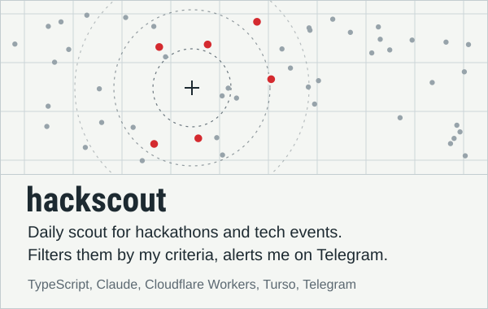
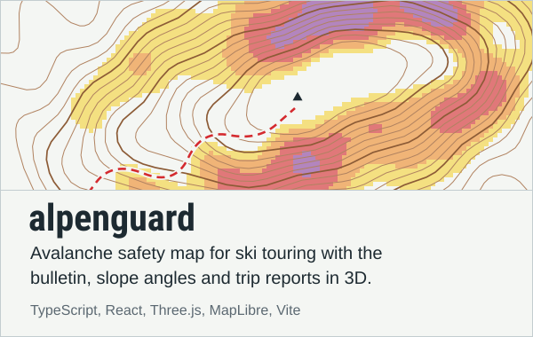
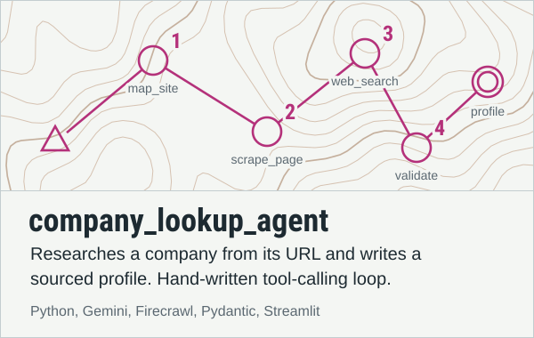
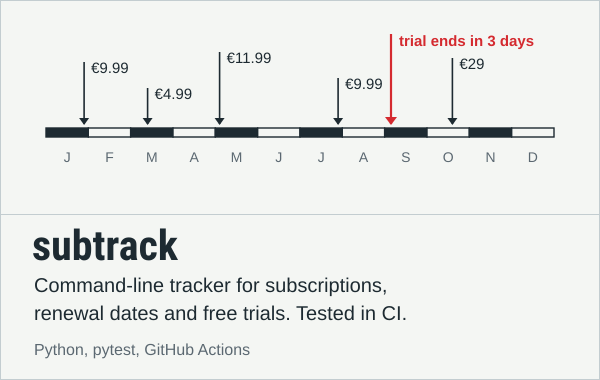

<picture><source media="(prefers-color-scheme: dark)" srcset="assets/hero-dark.svg"></picture>

I'm Fanis, a tech enthusiast in my first year of Management Science and Technology at AUEB in Athens. I learn by building: small AI agents and web tools in Python and TypeScript, usually for a problem I actually have. Long term, I want to start a company.

### Projects

<a href="https://github.com/fanispapaspyrou/hackscout"><picture><source media="(prefers-color-scheme: dark)" srcset="assets/hackscout-dark.svg"></picture></a>
<a href="https://github.com/fanispapaspyrou/alpenguard"><picture><source media="(prefers-color-scheme: dark)" srcset="assets/alpenguard-dark.svg"></picture></a>

<a href="https://github.com/fanispapaspyrou/company_lookup_agent"><picture><source media="(prefers-color-scheme: dark)" srcset="assets/company_lookup_agent-dark.svg"></picture></a>
<a href="https://github.com/fanispapaspyrou/subtrack"><picture><source media="(prefers-color-scheme: dark)" srcset="assets/subtrack-dark.svg"></picture></a>

alpenguard runs live at [alpenguard-theta.vercel.app](https://alpenguard-theta.vercel.app).

### What I build with

- **Python** for agents, command-line tools and Streamlit apps
- **TypeScript and React** with Vite, Tailwind, GSAP, Three.js and MapLibre
- **AI tooling:** Claude Code, Gemini function calling, MCP, Firecrawl
- **Shipping:** GitHub Actions, Cloudflare Workers, Vercel

### Away from the keyboard

- Led my school's CanSat team in 2024. We designed, built and launched a can-sized satellite prototype in the Greek national competition.
- Skiing every winter since ski academy as a kid, which is where alpenguard came from. I also run: 5 km in 20:40.
- On the sponsors team at FSDET, the DMST student conference.

Right now I'm working through CS50x and went to my first hackathon in November 2026. I'm looking for teammates for the next ones: find me on [LinkedIn](https://www.linkedin.com/in/fanis-papaspyrou).
